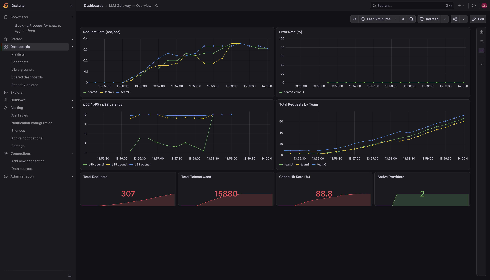
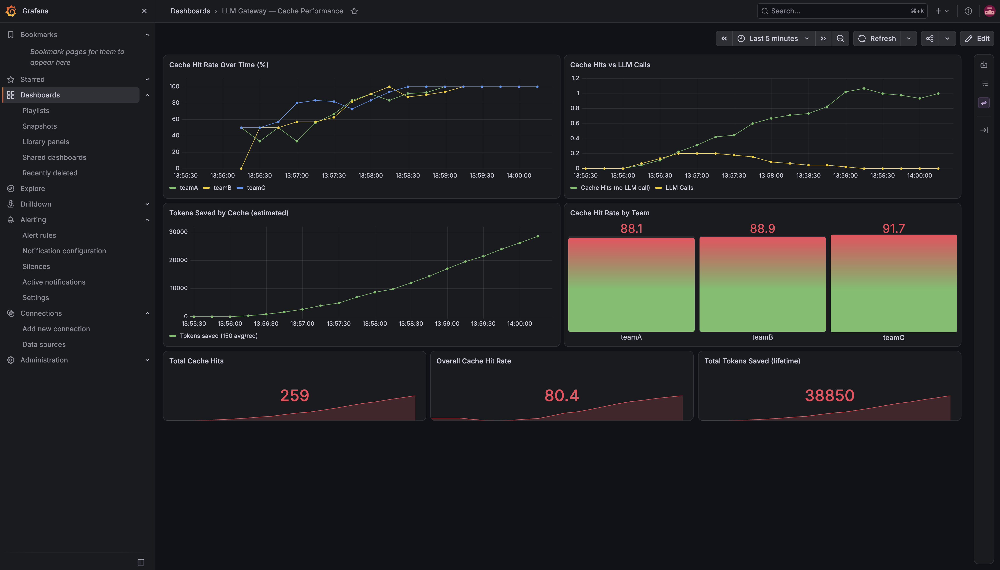
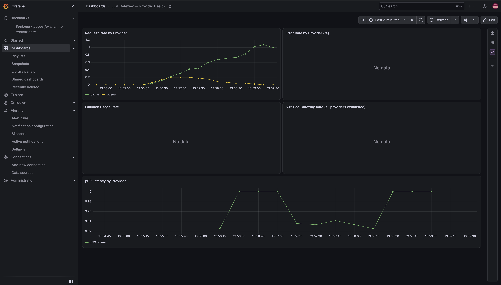

# LLM Gateway

A production-grade reverse proxy for LLM providers, written in Go. Teams send requests through one endpoint; the gateway handles authentication, rate limiting, semantic caching, resilience, and observability.

Built to demonstrate senior backend engineering: stateless horizontal scaling, distributed rate limiting, vector similarity search, circuit-breaker-based resilience, and a full Grafana observability stack — all running on a single binary.

---

## Architecture

```
Client
  │
  │  POST /v1/chat/completions
  │  Authorization: Bearer <team-token>
  │
  ▼
┌─────────────────────────────────────────────────────────┐
│                     LLM Gateway (Go)                     │
│                                                         │
│  1. Auth          ── invalid token ──────────→ 401      │
│         │                                               │
│  2. Rate Limit    ── bucket empty ───────────→ 429      │
│         │                    │                          │
│         │               Redis (token bucket)            │
│         │                                               │
│  3. Semantic Cache── cache hit ──────────────→ 200 ✓   │
│         │ miss               │                          │
│         │               Redis (HNSW index)              │
│         │                                               │
│  4. Router ── circuit breaker open? skip upstream       │
│         ├──→ OpenAI   (primary)                        │
│         ├──→ Anthropic (fallback 1, model swap)        │
│         └──→ Gemini   (fallback 2, model swap)         │
│         │                                               │
│  5. Log + Metrics (Prometheus /metrics)                 │
└─────────────────────────────────────────────────────────┘
  │
  ▼
Response to client
```

---

## What it does

| Capability | Implementation |
|-----------|---------------|
| **Multi-team auth** | SHA-256 hashed bearer tokens; zero plaintext secrets in config |
| **Per-team rate limiting** | Redis token bucket via atomic Lua script; correct under concurrent replicas |
| **Semantic caching** | Embed prompt → HNSW KNN search in Redis → cosine similarity threshold |
| **Multi-provider routing** | Tries upstreams in order; swaps model field on fallback |
| **Circuit breaker** | Per-provider CLOSED/OPEN/HALF-OPEN; single probe on recovery |
| **Structured logging** | One JSON line per request: team, requestID, provider, latency, tokens |
| **Prometheus metrics** | requests_total, tokens_total, cache_hits_total, request_duration_seconds |
| **Grafana dashboards** | Gateway overview, cache performance, provider health — auto-provisioned |
| **Graceful shutdown** | SIGTERM drains in-flight requests (10s window) before exit |

---

## Quick start (local dev)

```bash
# 1. Start Redis with vector search
docker run -p 6380:6379 redis/redis-stack-server:latest

# 2. Configure
cp config.example.yaml config.yaml
# Fill in your LLM provider API keys
# Set upstream base_url to: http://localhost:<provider-port>/v1
# Generate team tokens:
#   echo -n "your-token" | sha256sum   → paste result as key_hash

# 3. Run
go run .

# 4. Call it
curl -X POST http://localhost:8030/v1/chat/completions \
  -H "Authorization: Bearer <team-token>" \
  -H "Content-Type: application/json" \
  -d '{"model": "gpt-4.1-mini", "messages": [{"role": "user", "content": "hello"}]}'
```

> **Note:** For local dev (`go run .`) use `localhost` in upstream URLs. For docker compose, change upstream URLs to `host.docker.internal` so the gateway container can reach services on your host machine.

---

## Full stack with observability

Run the complete stack — gateway, Redis, Prometheus, and Grafana — in one command:

```bash
docker compose up
```

The gateway image is built automatically. Two-stage distroless build — final image is ~20 MB, runs as non-root.

> **Note:** Update upstream `base_url` values in `config.yaml` from `localhost` to `host.docker.internal` before running docker compose so the gateway container can reach your LLM provider.

| Service | URL | Credentials |
|---------|-----|-------------|
| LLM Gateway | http://localhost:8030 | Bearer token from config |
| Prometheus | http://localhost:9090 | — |
| Grafana | http://localhost:3000 | admin / admin |

Grafana dashboards are provisioned automatically on first boot — no manual import needed.

### Dashboards

**Gateway Overview** — request rate per team, error rate, p50/p95/p99 latency, total requests & tokens



**Cache Performance** — cache hit rate, hits vs LLM calls, tokens saved per team



**Provider Health** — request rate per provider, error rate, fallback usage, p99 latency



---

## Kubernetes

```bash
# 1. Create namespace
kubectl apply -f k8s/namespace.yaml

# 2. Create config secret
kubectl create secret generic llm-gateway-config \
  --from-file=config.yaml=config.yaml \
  --namespace llm-gateway

# 3. Deploy
kubectl apply -f k8s/deployment.yaml
kubectl apply -f k8s/service.yaml
kubectl apply -f k8s/hpa.yaml
```

Deployment runs 2 replicas with Prometheus scrape annotations. HPA scales between 2 and 10 replicas at 70% CPU. Rate limiting stays correct under horizontal scale — all state lives in Redis.

---

## Testing

```bash
# Unit tests + race detector
go test -race ./...

# With coverage
go test -race -cover ./internal/...

# Integration tests (requires Redis)
REDIS_ADDR=localhost:6380 go test -race ./internal/ratelimiter/

# Benchmarks
go test -bench=. -benchmem ./internal/cb/ ./internal/auth/ ./internal/proxy/

# Static analysis
go vet ./...
golangci-lint run ./...
```

| Package | Coverage | What's tested |
|---------|----------|---------------|
| `auth` | 100% | valid token, wrong token, missing header, empty token, case sensitivity |
| `cb` | 100% | state transitions, concurrent access, single probe in HALF-OPEN |
| `config` | 100% | YAML loading, env var overrides, invalid input |
| `proxy` | 100% | 200/4xx/5xx responses, unreachable server, connection drop mid-body |
| `router` | 100% | primary success, fallback on open CB, 4xx stops chain, model swap |
| `ratelimiter` | — | integration, needs `REDIS_ADDR` |

Benchmark results (Apple M3 Pro):

| Benchmark | Result |
|-----------|--------|
| Circuit breaker `Allow()` | **4 ns/op, 0 allocs** |
| Auth (SHA-256 + map lookup) | 113 ns/op, 2 allocs |
| Proxy round-trip (localhost) | 54 µs/op |

---

## Load test

```bash
k6 run scripts/loadtest.js \
  -e GATEWAY_URL=http://localhost:8030 \
  -e TEAM_TOKEN=your-team-token
```

Results (5 concurrent users, LiteLLM upstream):

| Metric | Value |
|--------|-------|
| Throughput | 3.4 RPS |
| p95 latency | 1.99s |
| Success rate | 99.4% |

Gateway overhead is ~5ms (p95 from circuit-breaker benchmarks). The dominant latency is upstream LLM call time (~1s avg). Bottleneck is the LLM provider, not the gateway.

---

## Alerting

Prometheus alert rules are defined in `prometheus/alerts.yml`:

| Alert | Condition |
|-------|-----------|
| `HighErrorRate` | Error rate > 5% for any team over 5 minutes |
| `HighLatency` | p99 > 3s for any provider over 2 minutes |
| `LowCacheHitRate` | Cache hit rate < 20% over 10 minutes |
| `AllProvidersFailing` | 502 rate > 0.1/sec for 1 minute |

---

## Implementation notes

**Rate limiting atomicity** — the token-bucket refill and consume happen inside a single Lua script executed atomically in Redis. No race condition possible across multiple gateway replicas.

**Semantic cache** — every cache lookup embeds the query (1536-dim float32 vector), runs an HNSW KNN search, and checks the cosine distance against a configurable threshold. A distance ≤ `1 - similarity_threshold` is a hit. The same question phrased differently ("capital of France?" vs "what's France's capital?") returns the cached answer.

**Circuit breaker** — per-provider state machine with a `probeInFlight` guard: only one request is allowed through in HALF-OPEN state. Concurrent requests during recovery are rejected, preventing thundering-herd against a recovering provider.

**Context propagation** — `r.Context()` flows from the handler through the router into every upstream HTTP call. Requests are cancellable on client disconnect or graceful shutdown.

**Stateless design** — the gateway holds no per-request state. All state (token buckets, vector index) lives in Redis. Replicas can be added or removed without coordination.

---

## Milestones

| # | Focus | Status |
|---|-------|--------|
| M1 | Skeleton — auth, single provider, structured logging | ✅ |
| M2 | Resilience — circuit breaker, fallback, model swap | ✅ |
| M3 | Rate limiting — Redis token bucket, Lua atomicity | ✅ |
| M4 | Semantic cache — embed, HNSW vector search, TTL | ✅ |
| M5 | Observability — Prometheus metrics, /metrics endpoint | ✅ |
| M6 | Ship — Dockerfile, docker-compose, K8s + HPA, load test | ✅ |
| M7 | Grafana — dashboards, alerting rules, full observability stack | ✅ |

---

## Docs

| Doc | What it covers |
|-----|----------------|
| [docs/architecture.md](docs/architecture.md) | Component map, package structure, dependency graph |
| [docs/request-lifecycle.md](docs/request-lifecycle.md) | Happy path, all failure paths, circuit breaker states |
| [docs/configuration.md](docs/configuration.md) | Every config field with type and purpose |
| [docs/runbook.md](docs/runbook.md) | Running locally, tuning knobs, log format, Redis ops |
| [docs/decisions/](docs/decisions/) | ADRs by milestone — what was chosen, what was rejected, why |
